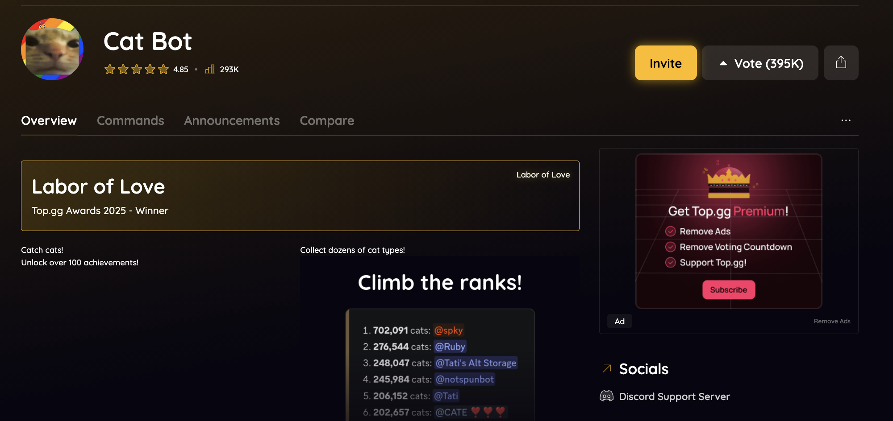
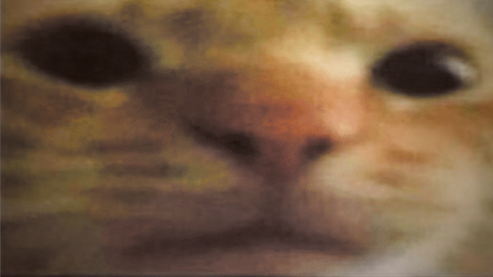
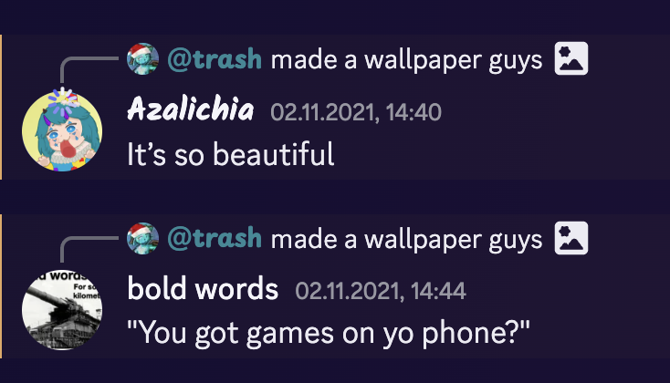
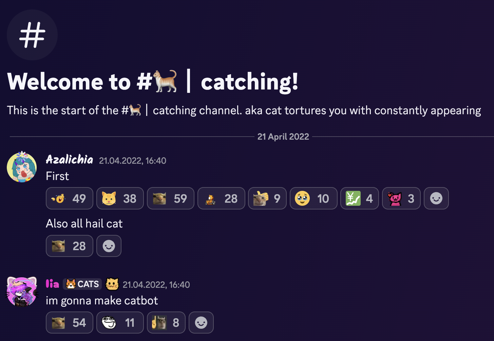
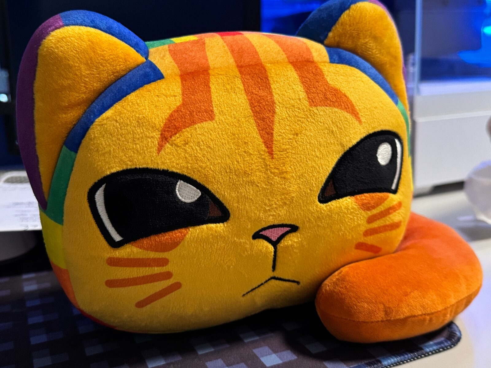

the reason Cat Bot, one of discord's biggest bots EVER, exists is because i once made a funny wallpaper, and i'll never stop bragging about it

having finally received my cat bot plush i felt this would be an appropriate time to retell the tale as old as time...

## november 2021

okay maybe NOT as old as time but i was in dire need of a silly pc wallpaper and decided to craft one myself

i literally grabbed an image of a cat's face and stretched it to fill the 16:9 screen, then did some color corrections to make it look brighter and warmer

here it is in all its glory. feel free to download and use yourself if you're into that i guess

i shared it in my game-adjacent discord server, someone asked to make a sticker out of it and it quickly became a meme

## cat chain

you HAD to be there to experience the cat. it was glorious, outstretched for thousands of messages, true human cooperation at its best

here's [footage of the staring cat thread](https://www.youtube.com/watch?v=iFWXP_RFXyc) masterfully presented by none other than lia (milenakos)

## wait who is lia again

surely you know her, she made cat bo- OH THAT CAT BOT???

that cat bot, INDEED, created in the beautiful late april of 2022. Cat Bot had a couple fun commands and allowed users to collect cats

the single genius design decision that, i believe, led to its success is *how* the cats were caught.

instead of `/catch` or `/garden claim package: swift` (if you know you know) the cats APPEARED OUT OF THIN AIR. the bot itself would barge into the channel with a huge staring cat that you could catch. if the server had Cat Bot *you knew* it had Cat Bot. 

## well um

the bot just kept growing outside our community, after my egregiously lazy ass finally added it to my own server it was already in 100 others

and then 1000 and 10000 and wHAT 100k?????

over those couple years i had the privilege to do important volunteering work for the bot, drawing all cat icons, designing updates, mechanics, etc. haven't touched its code ever and that's probably better for the code lmao

for now the story concludes with me receiving my Makeship Cat Bot Plush Official Real True ✔ Verified.

this has been a wild chain of dominoes and i wouldn't want it any other way.

p.s. shoutout to lia and nathan!!